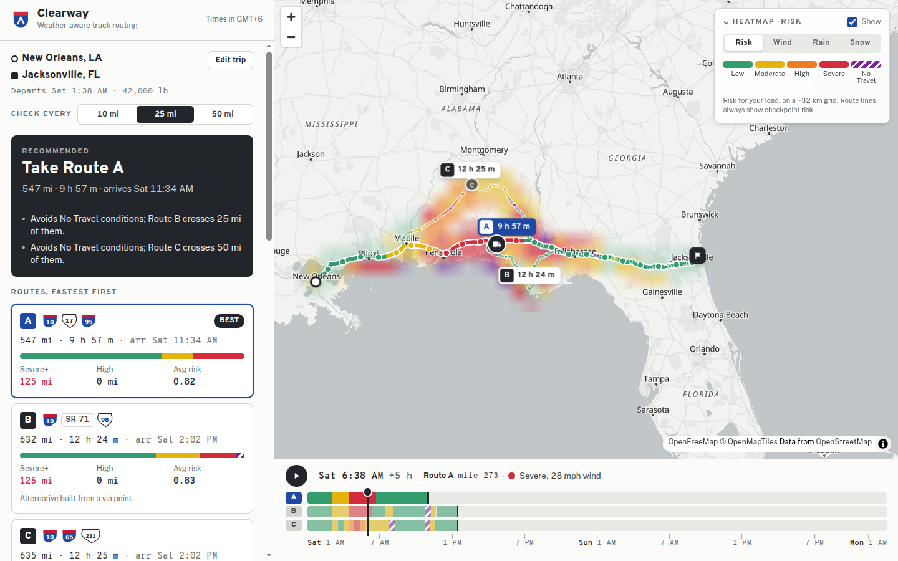

# Clearway: weather-aware truck routing

Clearway helps a truck driver pick the safest of three routes. Enter an origin, a destination, a departure time and the load weight. Clearway checks the forecast at every checkpoint for the hour the truck actually gets there, classifies the risk with the assessment's wind, rain, snow and load rules, and recommends a route. Routes, checkpoints, ETAs and a 0-48 hour corridor heatmap are all on one map.

- **Live app:** _add the Render URL after deploying_
- **Walkthrough:** _add the Loom link_



_Above: the real forecast on 10 Oct 2026. Routes B and C cross No Travel conditions near the Florida panhandle, so Route A is recommended even though it has 125 Severe miles._

## How it works

```
origin, destination, departure, load, interval
        │
        ▼
1. Routing      3 route options (TomTom truck routing, or OSRM + synthesized alternatives)
2. Checkpoints  every 10 / 25 / 50 mi along each route, each with its own ETA
3. Weather      Open-Meteo hourly forecast, sampled at each checkpoint's ETA
4. Risk         wind (with load rules), rain and snow → Low … No Travel per checkpoint
5. Ranking      No Travel mi → Severe mi → High mi → average risk → travel time
6. Heatmap      corridor grid × 48 h of forecasts, scrubbed with the timeline slider
```

### 1. Routes

- **With `TOMTOM_API_KEY` set**, routes come from TomTom's truck profile: `travelMode=truck`, gross weight (35,000 lb tare plus the load), 53 ft trailer dimensions, a 65 mph governed speed and the departure time. TomTom returns up to two alternatives. Per-point drive times come from its `progress` data.
- **Without a key** (or if TomTom fails), the app falls back to the public OSRM server. OSRM has no truck profile, so each road segment is capped at 65 mph to get truck-like ETAs.
- **When the provider returns fewer than three routes** (OSRM usually returns one or two on long trips), the missing ones are built by routing through a via point pushed sideways off the fastest route. A candidate is kept only if:
  - it is at most 50% slower than the fastest route, and
  - no more than 75% of it runs within 1.5 km of another option.

  Out-and-back spurs created by via points are trimmed (`backend/planner/alternatives.py`). The UI labels these routes "Alternative built from a via point".

### 2. Checkpoints and ETAs

Checkpoints sit at mile 0, then every interval, then the destination (`checkpoints.py`). If the destination is within half a mile of the last regular checkpoint, it replaces that checkpoint instead of adding a near-duplicate.

- **ETA:** departure plus the routing API's cumulative drive time at that point, interpolated between route vertices.
- **Coverage:** each checkpoint stands for the stretch of road halfway to each neighbour, so the stretches add up to the route length exactly. That is how "Severe miles" are measured.
- **Driving time:** ETAs assume continuous driving. Hours-of-service breaks are not modelled.

### 3. Weather at the right moment

Open-Meteo provides hourly forecasts from its best-match model blend: high-resolution NOAA models over the US, global models elsewhere. For each checkpoint's ETA (`weather.py`):

- **Wind and temperature** are instantaneous values, so they are interpolated linearly between the surrounding hours.
- **Rain and snow** are totals over the preceding hour, so the checkpoint uses the hour interval that contains the ETA. A truck passing at 14:20 gets the 14:00-15:00 total, which Open-Meteo stores at 15:00.
- **Rain rate** is Open-Meteo's `rain` plus `showers` (convective rain is reported separately). Snow is `snowfall`. Units are requested in mph and in/hr.

### 4. Risk rules

Implemented in `backend/planner/risk.py`, with every boundary covered by tests in `tests/test_risk.py`.

| Condition | Low | Moderate | High | Severe | No Travel |
|---|---|---|---|---|---|
| Wind (mph) | <25 | 25-34 | 35-44 | 45-54 | ≥55 |
| Rain (in/hr) | <0.10 | 0.10-0.25 | 0.25-0.50 | 0.50-1.00 | >1.00 |
| Snow (in/hr) | <0.5 | 0.5-1.0 | 1.0-2.0 | 2.0-3.0 | >3.0 |

Load rules raise the wind level: 45-54 mph with more than 30,000 lb becomes No Travel, and 35-44 mph with more than 40,000 lb becomes Severe. A checkpoint's level is the worst of its three conditions. The UI names the condition that drove it, for example "Wind 48 mph with a 42,000 lb load".

Interpretation choices:

- **Boundaries.** Each band includes its lower bound (25.0 mph is Moderate, 0.25 in/hr is High). The table writes the top rain and snow bands as a strict ">", so exactly 1.00 in/hr of rain and exactly 3.0 in/hr of snow are still Severe.
- **Wind** means sustained 10 m wind speed. Gusts are shown but not classified.
- **Load** is the cargo weight the user enters, capped at 50,000 lb. A loaded 5-axle rig is legally limited to 80,000 lb gross, which leaves roughly 45,000 lb for cargo. The load-rule thresholds are strict ("> 30,000 lb").

### 5. Recommendation

Routes are sorted lexicographically, in the order the brief lists (`recommendation.py`):

0. **Fewest No Travel miles.** The brief's list doesn't mention No Travel, but a No Travel stretch is worse than Severe, so it ranks first.
1. Fewest Severe miles
2. Fewest High miles
3. Lowest average risk: the mile-weighted mean of Low=0 … No Travel=4
4. Shortest travel time

Miles are compared at 0.1 mi and average risk at 0.01, so floating-point noise never decides. In calm weather every risk criterion ties and the fastest route wins. For each rival route, the UI shows the first criterion that separated it from the winner. If every route crosses No Travel conditions, the app says so and suggests a later departure.

### 6. Corridor heatmap

The backend builds a grid of cells within 25-70 km of any route (scaled to trip length). The grid is square in Web Mercator, and cell sizes come from a fixed ladder so overlapping trips reuse cached forecasts (`heatmap.py`). For 50 hourly frames starting at departure, it sends:

- the load-aware risk index
- wind, rain and snow values

The risk index is continuous between thresholds, but it is truncated so it always floors to the same level a checkpoint would get. That keeps the heatmap and the checkpoints in agreement.

The frontend paints the grid into a tiny canvas, one pixel per cell, and hands it to MapLibre as a canvas source. The GPU's linear filtering blends neighbouring cells into a smooth field. Moving the slider interpolates between forecast hours and repaints a few hundred pixels, then uploads that one frame (`lib/heatPainter.ts`). The slider runs at display frame rate, with no tile reloads or GeoJSON re-parsing: playback measured a steady 60 fps in Chrome.

Wind is an instantaneous value, so it is interpolated at its timestamp. Rain and snow are hourly totals that cover the hour before their timestamp, so the painter centres them on the middle of that hour. At any moment the heatmap then matches what a checkpoint would report to within half an hour, instead of lagging by up to an hour.

The **timeline dock** under the map runs from departure to departure + 48 h, with one row per route showing its risk over driving time. Dragging or playing it moves the heatmap and each route's truck marker together. Clicking a checkpoint jumps the timeline to that checkpoint's ETA.

### Weather API budget

Open-Meteo's free tier allows about 600 location lookups per minute (each location in a multi-location request counts). A plan therefore:

- de-duplicates locations on a 0.05° lattice (finer than the model grid);
- caches forecasts for 30 minutes;
- gives the heatmap a fixed 180-cell budget;
- never requests more than 560 locations. A very long trip at a 10-mile interval gets a clear "try a longer interval" message.

Checkpoint weather is queued ahead of the heatmap grid on one shared request pool, so under the quota the checkpoint requests are counted first, and they must succeed. If the grid fetch is rate-limited, the plan still returns, with a note that the heatmap is unavailable. Setting `OPEN_METEO_API_KEY` switches to the paid endpoint.

## Running locally

Requirements: Python 3.12+ with [uv](https://docs.astral.sh/uv/), and Node 20+.

```bash
# API on :8000
cd backend
uv sync
uv run python manage.py runserver

# UI on :5173 (proxies /api to :8000)
cd frontend
npm install
npm run dev
```

No API keys are needed. To use TomTom truck routing, get a free key at developer.tomtom.com (no credit card required) and run `TOMTOM_API_KEY=... uv run python manage.py runserver`. See `backend/.env.example` for the other settings.

### Tests and checks

```bash
cd backend && uv run pytest && uv run ruff check . && uv run ruff format --check .
cd frontend && npm test && npm run typecheck && npm run lint
```

Backend tests cover:

- every risk boundary and load rule;
- checkpoint placement and coverage;
- weather time-binning;
- each ranking criterion;
- provider parsing for OSRM, TomTom and Open-Meteo, with mocked HTTP;
- spur trimming;
- the API end to end with fake providers, including heatmap degradation.

## Deploying (Render)

The repo is a single Docker service: Node builds the React app, then Django serves the API and the static bundle through WhiteNoise. Hashed assets are pre-compressed with brotli and gzip and cached as immutable.

1. Push to GitHub, then in Render choose **New → Blueprint** and select the repo. `render.yaml` defines the service and generates `DJANGO_SECRET_KEY`.
2. Optionally set `TOMTOM_API_KEY` (and `OPEN_METEO_API_KEY`) in the service's environment.

To run the production image locally:

```bash
docker build -t clearway .
docker run -p 8080:8000 -e DJANGO_SECRET_KEY=dev -e DJANGO_ALLOWED_HOSTS=localhost clearway
```

## Project layout

```
backend/
  config/            Django settings and URLs
  planner/
    risk.py          risk thresholds, load rules, heatmap risk index
    checkpoints.py   checkpoint placement, ETAs, coverage
    weather.py       forecast sampling at an ETA
    recommendation.py exposure summary and ranking
    alternatives.py  via-point alternatives, spur trimming
    heatmap.py       corridor grid
    service.py       the planning pipeline
    serializers.py   request validation, response shape
    views.py         /api/plan, /api/geocode, /api/health
    providers/       TomTom, OSRM, Photon, Open-Meteo clients
    tests/
frontend/src/
  components/        TripForm, MapView, TimelineDock, Results, CheckpointList, HeatControls
  lib/               geometry, heatmap painting and color scales, formatting
```

## Known limitations

- Place search covers the US and Canada, since the risk rules use mph and lb. Set `GEOCODE_COUNTRIES` to change it.
- ETAs ignore hours-of-service breaks, so long trips arrive earlier than a compliant driver would.
- ETAs are shown in the viewer's time zone, not the local time at each checkpoint.
- Without a TomTom key, routes use a car profile, with truck speeds approximated by the 65 mph cap and no truck restrictions such as low bridges or hazmat.
- The heatmap grid is coarser on long trips (about 30-60 km cells) to stay within the free weather API's limits.
